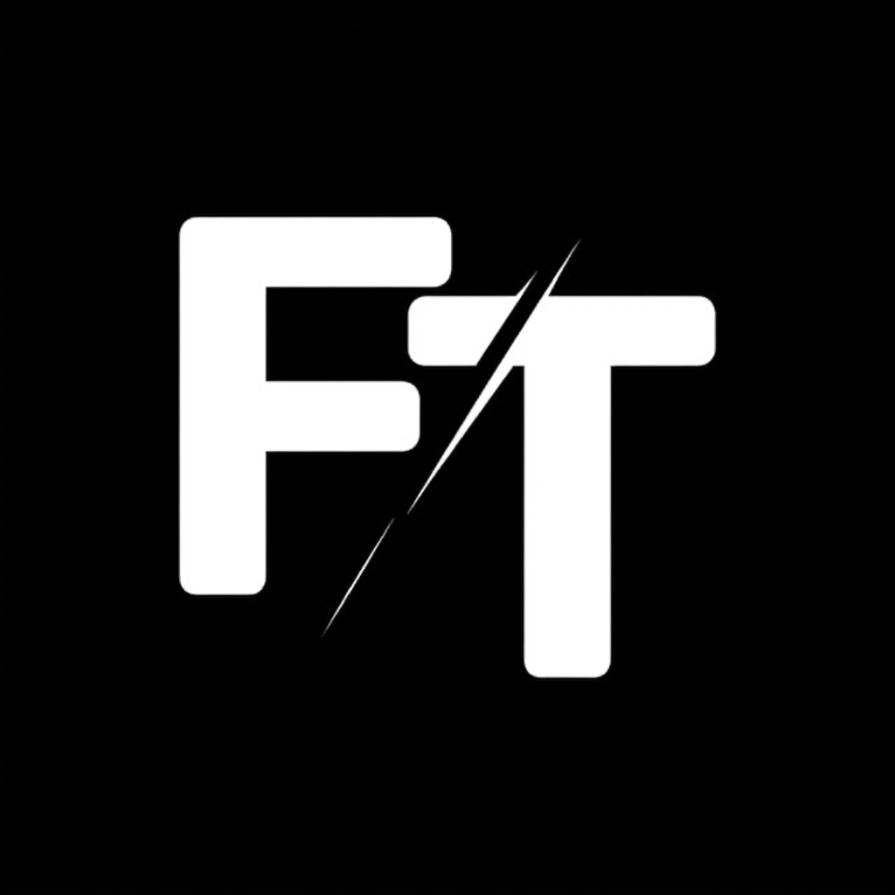
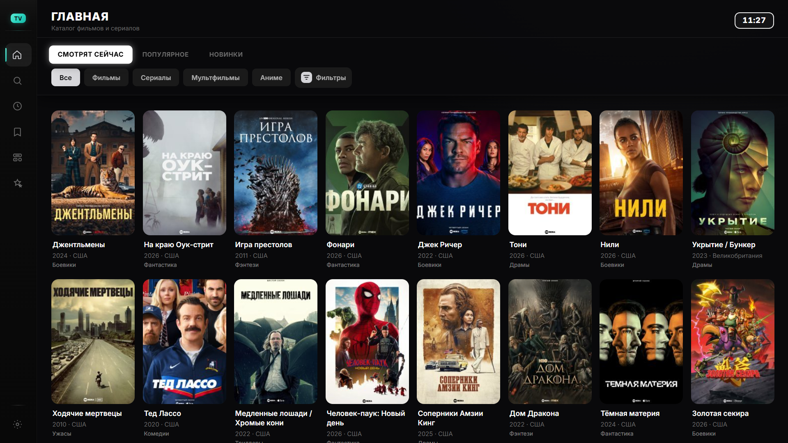
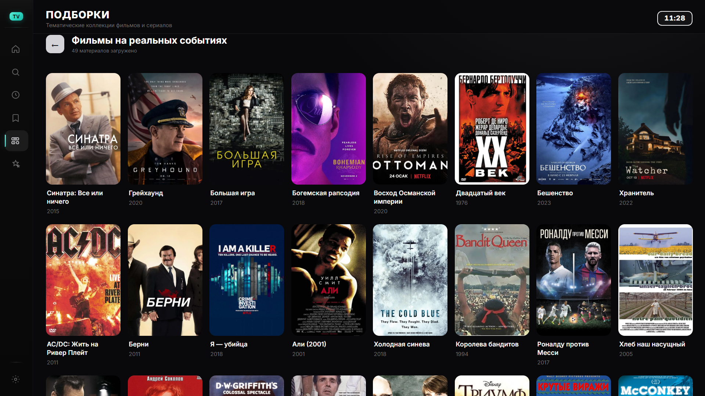
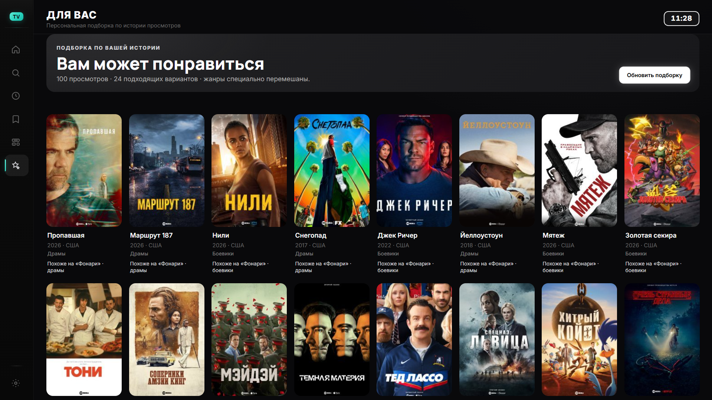
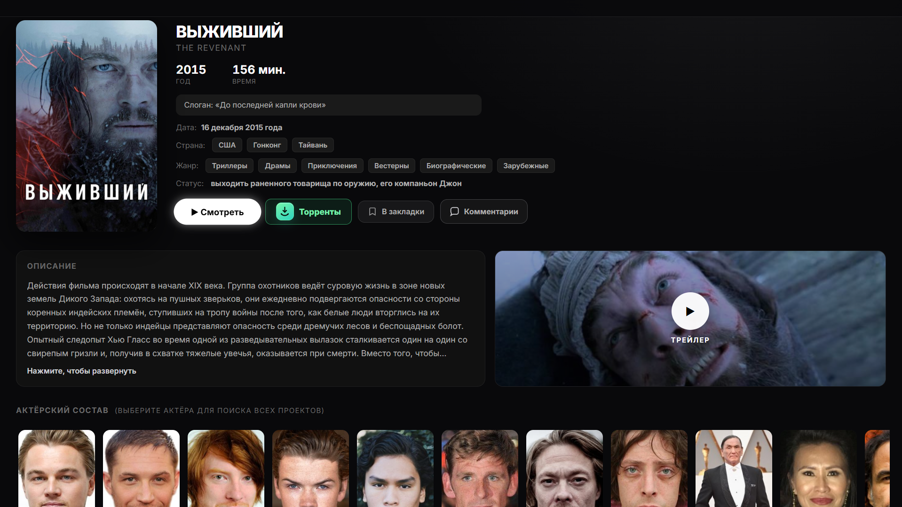
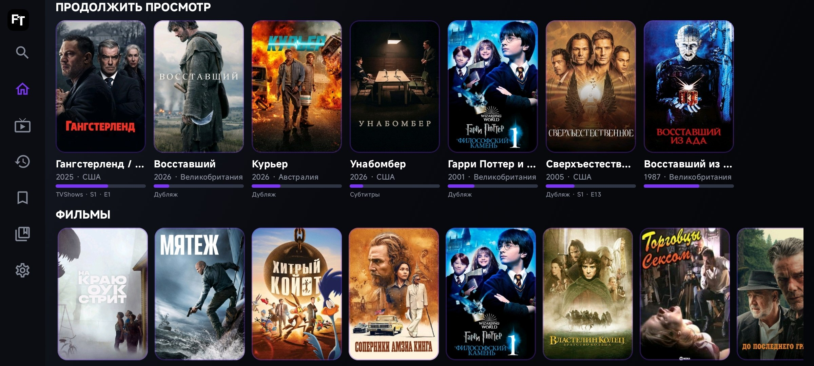
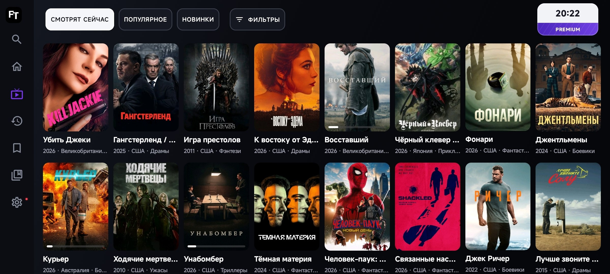
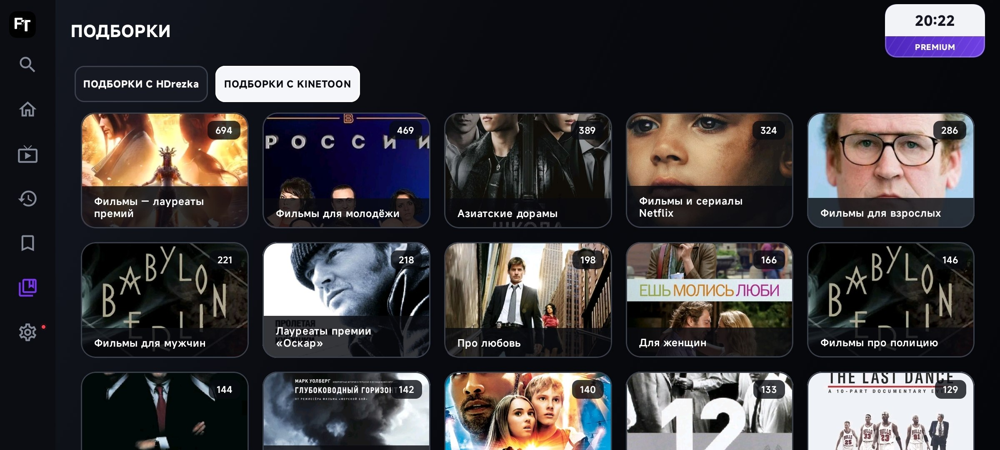
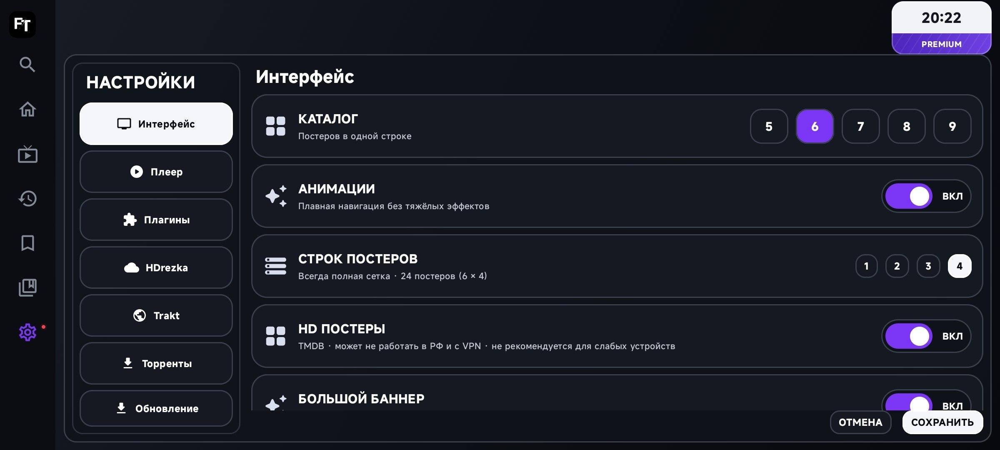

<h1>
  
  Fishka TV
</h1>

### Удобный медиа-агрегатор для Windows и Android TV

Fishka TV объединяет каталог, поиск, карточки фильмов и сериалов, подключаемые внешние источники и удобный плеер в одном интерфейсе. Приложение не является видеохостингом и не продаёт доступ к контенту. 

[Все версии и описание релизов](https://github.com/Rtreterasd/FishkaTVapp/releases)

## Скриншоты Windows

<table>
  <tr>
    <td width="50%" align="center">
      
    </td>
    <td width="50%" align="center">
      
    </td>
  </tr>
  <tr>
    <td width="50%" align="center">
      
    </td>
    <td width="50%" align="center">
      
    </td>
  </tr>
</table>

## Скриншоты Android TV

<table>
  <tr>
    <td width="50%" align="center">
      
    </td>
    <td width="50%" align="center">
      
    </td>
  </tr>
  <tr>
    <td width="50%" align="center">
      
    </td>
    <td width="50%" align="center">
      
    </td>
  </tr>
</table>

## Возможности

- каталог фильмов, сериалов, мультфильмов и аниме;
- поиск, подборки, история и закладки;
- продолжение просмотра с сохранённой позиции;
- синхронизация истории и прогресса через аккаунт Trakt по выбору пользователя;
- выбор озвучки, качества, сезона и серии;
- полноэкранный плеер с субтитрами;
- просмотр трейлеров внутри приложения;
- подключение внешних источников, которые пользователь настраивает самостоятельно;
- поддержка 4K, HDR, Dolby Vision и многоканального звука при наличии совместимого видео и оборудования;
- работа с торрент-раздачами через встроенный или внешний TorrServer после самостоятельной настройки поискового API;
- управление мышью, клавиатурой, пультом и геймпадом;
- адаптивный интерфейс для монитора, телефона и телевизора.

## Управление

| Клавиша или кнопка | Действие |
|:---:|---|
| `Space` / `OK` | Пауза, продолжить или выбрать активную кнопку |
| `←` `→` | Навигация или перемотка назад/вперёд |
| `↑` `↓` | Навигация и вызов панели плеера |
| `Enter` | Выбрать активную кнопку |
| `F` | Полноэкранный режим в Windows |
| `Esc` / `Back` | Назад или закрыть плеер |

## Системные требования

### Windows

- Windows 10 или Windows 11, 64-bit;
- подключение к интернету;
- для 4K, HDR и Dolby Vision требуется совместимое оборудование и актуальный видеодрайвер.

### Android TV

- Android 7.0 или новее;
- процессор ARMv7 или ARM64;
- пульт с D-pad либо совместимый геймпад;
- для 4K, HDR, Dolby Vision и многоканального звука требуются совместимые телевизор, устройство и декодеры.

## Обратная связь

Если вы обнаружили ошибку, перейдите в Telegram-сообщество [FishkaTVapp](https://t.me/FishkaTVapp), откройте раздел **Баг-репорты** и приложите описание проблемы, модель устройства, версию приложения и по возможности скриншот.

## Конфиденциальность и аккаунты

- установщик и APK не содержат аккаунтов, cookies, токенов, истории или других данных пользователей;
- настройки и данные авторизации появляются только после действий пользователя на его устройстве;
- подключение HDRezka используется для каталога, истории и закладок. Для синхронизации прогресса плеера используется отдельное подключение Trakt;
- при включении внешней интеграции приложение передаёт соответствующему сервису только данные, необходимые для выбранной функции. Их дальнейшая обработка регулируется правилами этого сервиса;
- отключение аккаунта или очистка данных приложения удаляет локальные данные Fishka TV, но не удаляет сведения, которые уже хранятся в аккаунте внешнего сервиса;
- не передавайте другим людям свои пароли, cookies, токены и резервные копии данных приложения.

## Внешние источники и контент

- Fishka TV является независимым клиентским приложением и медиа-агрегатором;
- приложение не размещает и не загружает видео, торрент-файлы или magnet-ссылки на собственные серверы;
- адрес поискового API и другие пользовательские источники не включаются в официальную сборку и добавляются пользователем самостоятельно;
- результаты поиска, метаданные и ссылки могут поступать от независимых сторонних сервисов по запросу пользователя;
- разработчик не управляет сторонними сайтами, не гарантирует их доступность, безопасность, точность данных или правовой статус размещённых ими материалов;
- пользователь обязан использовать собственные аккаунты, разрешённые источники и только тот контент, к которому у него есть законный доступ, а также соблюдать правила внешних сервисов и законодательство своей страны.

Fishka TV не связан с HDRezka, TorrServer, Trakt, TMDB и другими упомянутыми сторонними сервисами и не заявляет об их поддержке или одобрении. Все названия, логотипы и товарные знаки принадлежат их владельцам.

## Лицензия и атрибуция

Программа ничего не хранит и не размещает: она показывает то, что доступно на сторонних сайтах и сервисах. За содержимое отвечают их владельцы. Полный текст лицензии — в программе: «Настройки → О программе → Лицензионное соглашение».

Постеры, описания и рейтинги — TMDB. This product uses the TMDB API but is not endorsed or certified by TMDB.

**Fishka TV — любимое кино дома.**

